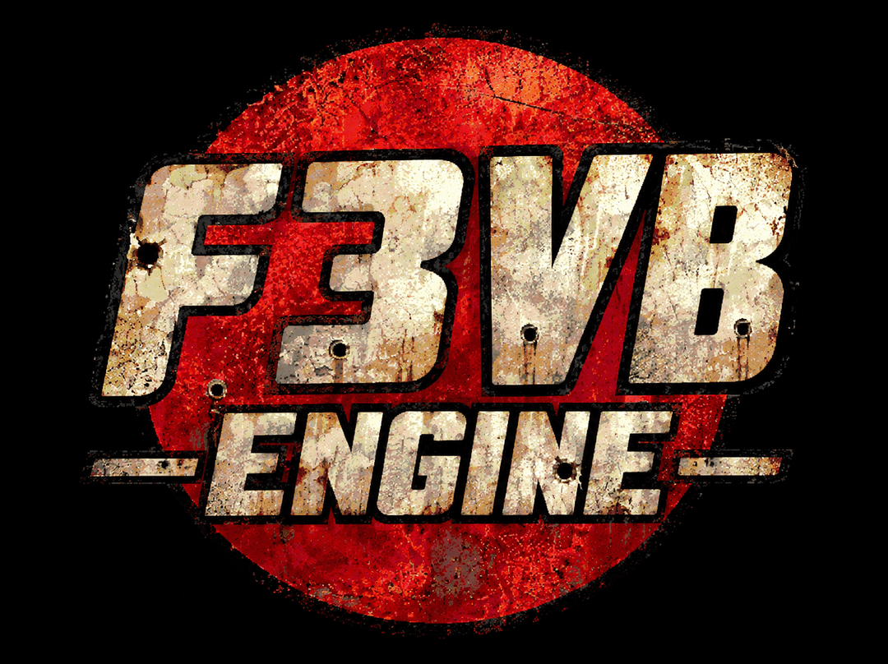

<p align="center"></p>

# F3VB Engine

**A clean-room, modern C++/OpenGL engine that runs the original *Van Buren* (cancelled Fallout 3 by Black Isle Studios) tech demo
straight from its own data files.**

> Status: **v21 (2026-11-05)**, built with MSVC on Windows (66/66 targets) and verified with the original demo. Playable tech demo: menus, intro videos, character creation, 3D maps, real-time combat.
> Not affiliated with, endorsed by or sponsored by Bethesda Softworks, ZeniMax, Microsoft, Interplay or Black Isle Studios.

---

## What it does
- **Reads the original demo directly.** It opens `resource.rht` and the whole `.grp` archives with no extraction. On first launch a Windows folder
  picker asks for the demo folder, and the choice is saved in `F3VB.ini` next to the `.exe`. No path is hard-coded.
- **Intro videos with sound.** The `.mve` files are Bink 1. They are decoded by the demo's own `binkw32.dll` inside a 32-bit helper process.
- **Animated 3D main menu**, matching the original:
  - the "FALLOUT 3" boxcar rolls in from the right;
  - the player and Cpl. Armstrong play their idle animations;
  - the clouds drift.
- **Character creation:**
  - SPECIAL, skills, tags and traits, with formulas measured against screenshots of the original game;
  - a live 3D preview whose appearance options change body type, sex, skin, hair, beard and hair color.
- **3D maps** built in memory from `.map` + `.8tre` + `.rle`, including entities, characters, creatures, weapons and lightmaps.
- **Gameplay:**
  - click-to-move with A* pathfinding over the real map geometry, with characters grounded by ray casts;
  - **real-time combat**, with walk, run, attack, hit and death animations from the demo's `.gr2` files;
  - dialogs run by the original scripts in our own Pawn/AMX VM;
  - a save/load format of our own.
- **Modern graphics:** any resolution and aspect ratio, MSAA, anisotropic filtering, vsync, fullscreen.
- **Self-verification:**
  - `F3VB.exe --autoteste` plays through the videos, the menu, character creation and every real map, then writes a report and screenshots;
  - `F3VBCheck --tudo` runs every script, dialog, animation, ground check and sound without opening a window.

## What it does NOT include
**No game data.** Not a single texture, model, sound, script, string table or DLL of the original game ships with this project. You need your own
copy of the Van Buren tech demo. See [`CLEANROOM.md`](CLEANROOM.md) and [`docs/LICENCAS_E_DIREITOS.md`](docs/LICENCAS_E_DIREITOS.md).

## Building (Windows)
Requirements: Visual Studio 2026 (MSVC, x64 and x86 toolsets) and CMake/Ninja (bundled with VS). There are no external dependencies.
```bat
:: "Developer Command Prompt for VS 2026"
cd viewer
build.bat
build\F3VB.exe
```
`build.bat` builds the 64-bit engine, the tools and tests, and the 32-bit video helper `F3VBVideo32.exe`.

## Controls (from the original `F3.ini` `[HotKeys]`, plus a few extras)
| Key | Action |
|---|---|
| Left click on ground | walk/run there |
| `A` / click the weapon slot | attack mode, then click a target (real-time combat) |
| Arrows, Numpad 2/4/6/8, PgUp/PgDn, mouse wheel, right-drag | camera |
| `I` `P` `C` | inventory, Pip-Boy, character |
| `G` `V` `L` `H` `M` | option tabs |
| `F5` / `F9` | quick save / load (extra) |
| `Esc` | menu |

## Repository layout
| Path | Contents |
|---|---|
| `viewer/src` | the engine (C++17/20): VFS, map builder, GR2/B3D readers, actors, ground/pathfinding, GUI, audio mixer, video player |
| `src/amx` | Pawn/AMX virtual machine (clean-room) |
| `tools/py` | Python research tools: extractor, converters, format probes, 137 tests |
| `docs/` | format specs (`docs/specs/*`), changelog, per-version request checklists, licenses |
| `third_party/` | blendergranny (MIT GR2 parser), with its license |

## Documentation
- [`docs/JOGO.md`](docs/JOGO.md): how the game works (Portuguese)
- [`docs/CHANGELOG.md`](docs/CHANGELOG.md): history v1 → v21
- [`docs/specs/`](docs/specs): GR2, B3D, prototypes, Bink, maps, GUI, scripts
- `docs/CONFERENCIA_V21.txt`: every request/screenshot of this version and its status

## Roadmap (short)
- **v22 (next):**
  - in-game sounds and positional audio;
  - hostile NPC AI with script teams; weapons, ammo and action points from the demo data;
  - inventory and items, doors, map travel (Junktown <-> Vault);
  - an optional **XPBD ragdoll** death (from the author's RPGGL engine);
  - fixing the last script VM functions; the Mesa console model.
- **Later:**
  - full **English + Brazilian Portuguese** support, including the dialogs;
  - **PBR** materials, **4K**, better textures and a future **ray-tracing** path;
  - **Vulkan / Direct3D 12 / Metal** back ends;
  - **ARM64, Linux, macOS and Android**;
  - **mods** and a toolset for **making new games** on this engine.

See `05_TODO_ROADMAP.txt`, `09_V22_PLAN.txt` and `10_FUTURE_VISION.txt`.

## Made with AI
The engine is developed by its author together with **Claude (Anthropic)**, working as a coding agent. The agent reads the demo files,
writes and tests the code in a sandbox (Wine + cross-compilation), and documents each decision. See `07_AI_USAGE.txt` in the project notes.

## License
The project's own code: **no license chosen yet (all rights reserved by the author)**. Third-party code keeps its own license
(blendergranny: MIT). *Fallout* and *Van Buren* are trademarks of their respective owners.
